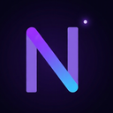

  

<h1 align="center">NecturaLabs</h1>

An independent software studio making developer tools, desktop apps and games.

## Open source

| Project | What it is |
| --- | --- |
| [Canopy](https://github.com/NecturaLabs/Canopy) | A fast, Linux-first Git client written in Rust. [canopy.necturalabs.com](https://canopy.necturalabs.com) |
| [nectura-ui](https://github.com/NecturaLabs/nectura-ui) | Our egui component library: design tokens, themes, fonts, motion and components. |
| [worker-protocol](https://github.com/NecturaLabs/worker-protocol) | A file-based communication protocol for orchestrated AI agents. |
| [Neon Saturn](https://github.com/NecturaLabs/omarchy-neon-saturn-theme) | A dark neon violet theme for Omarchy, with 4K ringed-moon wallpapers. |
| [MapleStory MVP Detector](https://github.com/NecturaLabs/MapleStory-MVP-Detector) | Real-time MVP boss detection for MapleStory, running entirely in the browser. |
| [WarmaneMods](https://github.com/NecturaLabs/WarmaneMods) | Mods and patches for the Warmane World of Warcraft server. |

Found a bug or have an idea? Open an issue on the project it belongs to.
